<a id="top"></a>
<p align="center">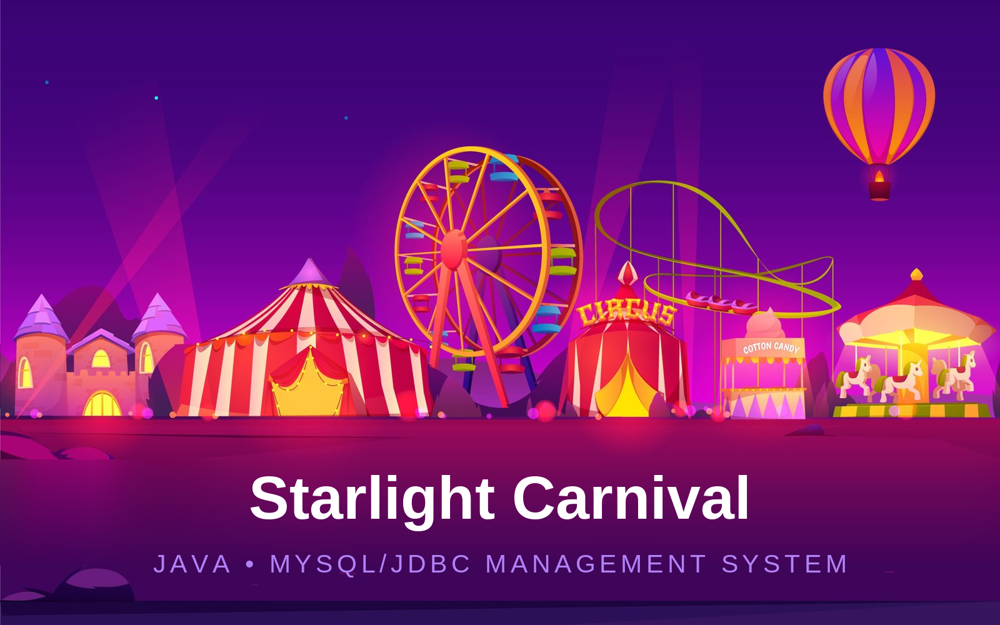</p>

<p align="center">     </p>

<h3 align="center"><i>One tour. Many towns. One database that keeps it all straight.</i></h3>

<p align="center">
<a href="The%20Starlight%20Carnival%20Project%20Documentation%20%28AI%20Assisted%29.pdf"><b>Project documentation (PDF)</b></a> &nbsp;·&nbsp;
<a href="#running-the-project"><b>Run it</b></a> &nbsp;·&nbsp;
<a href="#2-design"><b>See the EERD</b></a> &nbsp;·&nbsp;
<a href="#5-the-application"><b>See the app</b></a>
</p>

<p align="center">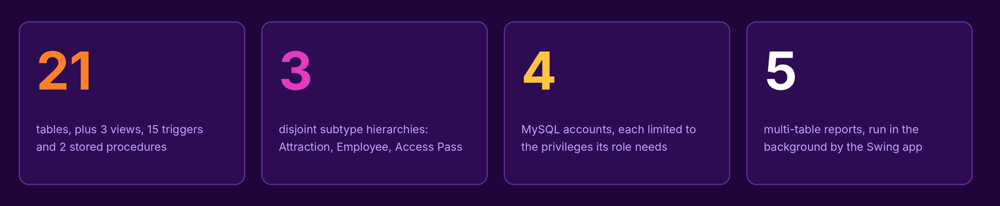</p>

> [!NOTE]
> This is a **database systems** project first and an application second. The schema, the constraints, the triggers and the role-based accounts in [`starlight_carnival.sql`](Starlight%20Carnival/starlight_carnival.sql) are the core of the submission. The Java Swing application is the front end we built on top of them.

<p align="center">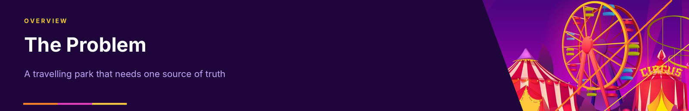</p>

## The Problem

The Starlight Carnival is a travelling amusement park. It moves from city to city through the year, stays for a few weeks at each venue, and runs the whole operation from a mobile headquarters. In every town it admits guests, sells food and souvenirs, runs rides and shows, pays its staff, and keeps mechanical rides safe, and it has to do all of that while the **location keeps changing**.

Without a central system, the questions management actually cares about are hard to answer. Which stop on the tour made money once the venue rental is paid? Which rides are eating the maintenance budget? Who are the customers worth keeping? Is a stall about to run out of stock? Cash, cards, a loyalty scheme and a rechargeable smart card make every sale a little different, and staff fall into very different jobs (ride operators, technicians, vendors, performers and general staff), each with their own details.

**We, Group G, designed and built the database and the front end that fix this.** One schema holds the locations, customers, staff, attractions, sales and maintenance history. Constraints and triggers keep the data valid, four MySQL accounts keep each role to the privileges it needs, and a Java Swing application gives each role its own way in.

**Keywords:** relational schema, EERD, supertype and subtype, MySQL, JDBC, Java Swing, triggers, stored procedures, role-based access.

[Back to top ↑](#top)

## Contents

**About the project**

- [The Problem](#the-problem)
- [Project formalities](#project-formalities)
- [Repository map](#repository-map)
- [Running the project](#running-the-project)

**The system**

1. [The business scenario](#1-the-business-scenario)
2. [Design](#2-design)
3. [The database](#3-the-database)
4. [Roles and security](#4-roles-and-security)
5. [The application](#5-the-application)
6. [Reports](#6-reports)
7. [Testing and findings](#7-testing-and-findings)
8. [Conclusion](#8-conclusion)

**Back matter**

- [References](#references)
- [AI disclosure](#ai-disclosure)
- [Licence and attribution](#licence-and-attribution)

<p align="center">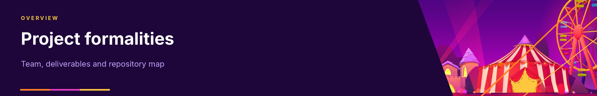</p>

## Project formalities

|               |                                                                       |
|---------------|-----------------------------------------------------------------------|
| **Course**    | COMP306 Database Systems (2026), University of KwaZulu-Natal          |
| **Project**   | The Starlight Carnival Management System (amusement park database)    |
| **Group**     | Group G                                                               |
| **Stack**     | MySQL 8.0, Java (Swing), JDBC through MySQL Connector/J               |

| Member                | Student number | Responsibility                                  |
|-----------------------|----------------|-------------------------------------------------|
| Jawad Kachbal         | 223037045      | Relational schema                               |
| Joshua Blom           | 224039813      | EERD and business scenario                      |
| Mahomed Valli Mahomed | 224005878      | SQL design and implementation, front end        |
| Abiel Govender        | 224058851      | SQL design and implementation                   |
| Andiswa Hlengwa       | 221002430      | Business scenario, front end                    |

### Deliverables

| Deliverable                 | Where                                                                                                                                                                  |
|-----------------------------|------------------------------------------------------------------------------------------------------------------------------------------------------------------------|
| Business scenario (Phase 1) | [`Group G COMP306 Phase 1.pdf`](Group%20G%20COMP306%20Phase%201.pdf)                                                                                                   |
| EERD                        | [`The Starlight Carnival EERD Final.pdf`](The%20Starlight%20Carnival%20EERD%20Final.pdf)                                                                                |
| Relational schema           | [`Starlight Carnival Relationship Schema Group G Final-1.pdf`](Starlight%20Carnival%20Relationship%20Schema%20Group%20G%20Final-1.pdf)                                  |
| Database script             | [`Starlight Carnival/starlight_carnival.sql`](Starlight%20Carnival/starlight_carnival.sql)                                                                              |
| Java application            | [`Starlight Carnival/src/starlightcarnival`](Starlight%20Carnival/src/starlightcarnival)                                                                                |
| Project documentation       | [`The Starlight Carnival Project Documentation (AI Assisted).pdf`](The%20Starlight%20Carnival%20Project%20Documentation%20%28AI%20Assisted%29.pdf)                      |

## Repository map

```
.
├── README.md                                   this page
├── docs/readme/                                images used by this page (banners, diagrams)
│
├── Group G COMP306 Phase 1.pdf                 Phase 1: the business scenario
├── The Starlight Carnival EERD Final.pdf       Phase 2: the EERD
├── Starlight Carnival Relationship Schema Group G Final-1.pdf    Phase 2: the relational schema
├── The Starlight Carnival Project Documentation (AI Assisted).pdf   run guide and front-end write-up
├── Group G COMP306.txt, Group G - COMP306.txt  group member lists
├── 1. README FIRST (AI Assisted).md            the earlier, plain README
│
└── Starlight Carnival/                         the project folder (open this in IntelliJ)
    ├── starlight_carnival.sql                  schema, views, procedures, triggers, accounts, sample data
    ├── 2. Run Application (AI Assisted).bat    compile and launch on Windows
    ├── lib/mysql-connector-j.jar               JDBC driver
    └── src/starlightcarnival/
        ├── Main.java                           entry point, look and feel
        ├── LoginFrame.java                     animated login, role routing
        ├── DatabaseManager.java                JDBC wrapper: query, update, inTransaction
        ├── EntityConfig.java                   declarative metadata for every entity
        ├── EntityCrudPanel.java                one generic create/read/update/delete panel
        ├── MainFrame.java                      admin and guest shell with sidebar
        ├── SalesFrame.java                     four-step admission and pass workflow
        ├── MaintenanceFrame.java               log and browse maintenance jobs
        └── ReportsPanel.java                   five multi-table reports
```

[Back to top ↑](#top)

<p align="center">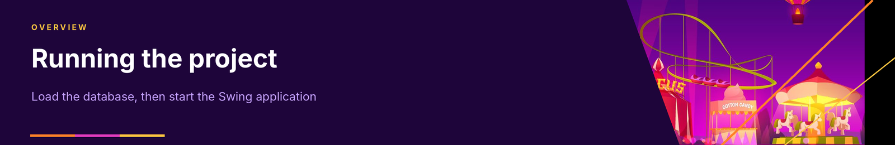</p>

## Running the project

You need to load the database **before** starting the application; otherwise the login screen reports that the required tables were not found.

| You need                          | For                                | Notes                                                             |
|-----------------------------------|------------------------------------|-------------------------------------------------------------------|
| MySQL Server 8.0 or later         | the database                       | with MySQL Shell (or the `mysql` client) to load the script       |
| JDK 17 or later                   | compiling and running the app      | we built with JDK 25 in IntelliJ; a JDK 21 build was also checked |
| IntelliJ IDEA (optional)          | opening the project as a module    | Community edition is enough                                       |
| `lib/mysql-connector-j.jar`       | JDBC driver                        | already included in the project folder                            |

### 1. Load the database

In MySQL Shell:

```
\connect root@localhost
SOURCE C:/path/to/Starlight Carnival/starlight_carnival.sql;
```

The script is re-runnable: it creates the `starlight_carnival` database if it is missing, drops and rebuilds every table, and then creates the views, procedures, triggers, the four user accounts and the sample data. From a normal shell you can load it with `mysql -u root -p < starlight_carnival.sql` instead.

### 2. Start the application

**Windows:** open the `Starlight Carnival` folder and double-click **`2. Run Application (AI Assisted).bat`**. It compiles the sources against the bundled connector and launches the login screen.

**Any platform, from the `Starlight Carnival` folder:**

```
mkdir -p out
javac -d out src/starlightcarnival/*.java
java -cp "out:lib/mysql-connector-j.jar" starlightcarnival.Main
```

(use `;` instead of `:` in the classpath on Windows). To point the app at another server, pass `-Ddb.host=…`, `-Ddb.port=…`, `-Ddb.name=…`, `-Ddb.user=…` and `-Ddb.password=…`.

**In IntelliJ:** open the `Starlight Carnival` folder, press **F4** (Module Settings), add `lib/mysql-connector-j.jar` under *Dependencies*, then run `Main.java`.

### 3. Log in

| Username                | Password    | Role        | What you get                                                  |
|-------------------------|-------------|-------------|---------------------------------------------------------------|
| `starlight_admin`       | `admin123`  | Admin       | Create, edit and delete on every entity, plus the reports     |
| `starlight_sales`       | `sales123`  | Sales       | The admission and access-pass workflow                        |
| `starlight_maintenance` | `maint123`  | Maintenance | Log and browse ride maintenance                               |
| `starlight_guest`       | `guest123`  | Guest       | Read-only view of every screen and the reports                |

These are real MySQL accounts, not rows in a business `USER` table, and the passwords are demo values for coursework only.

[Back to top ↑](#top)

<p align="center">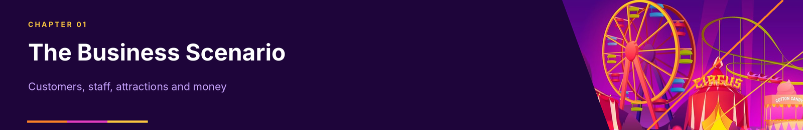</p>

## 1 The Business Scenario

This chapter summarises the Phase 1 scenario that the whole design came from.

### 1.1 The tour and its locations

The carnival travels between venues. A **Location** records the city, venue name, address, arrival and departure dates and the rental cost for the stay. One location hosts many admissions, transactions, employees and attractions, which lets management compare stops and decide which towns are worth returning to.

### 1.2 Customers and the Starlight Smart Card

Guests can sign up for a **Starlight Smart Card**, which is both a loyalty membership and a rechargeable payment method. Registration takes a name, surname, email, phone number and date of birth, and the **age group (Child, Adult or Senior) is calculated automatically from the date of birth**. A customer record then holds the signup date, card balance, loyalty points and card status. The balance is topped up at any booth or kiosk and spent on entry, stalls and premium passes.

Guests without a card can still enter by paying the standard fee. Their admission has no customer attached, and they pay in cash or by card.

### 1.3 Admissions, transactions and payments

At the gate, a card is scanned to check it is active and funded, and an **Admission** is recorded against the location with the entry time, the admission type, the fee paid and, later, the exit time. Every monetary event (entry fee, card top-up, stall purchase, access pass, refund) is a **Transaction**, linked to the location, the employee who processed it and, when a card was used, the customer. A transaction is settled by one or more **Payments**, each with a tender type (cash, credit card, debit card or smart card balance).

### 1.4 Premium access passes

An **Access Pass** lets a guest skip queues or reserve a seat. Every pass is exactly one of two subtypes:

- a **Ride Fast Pass**, tied to a ride and a time slot;
- a **Show Reservation**, tied to a show with a seat number and show time.

A single transaction can include several passes, and employees scan them at the attraction entrance so a pass cannot be reused.

### 1.5 The workforce

All staff are **Employees** (name, hire date, hourly wage and current location). Each employee belongs to exactly one specialised subtype:

| Subtype           | What makes it different                                                                                  |
|-------------------|----------------------------------------------------------------------------------------------------------|
| **Operator**      | Runs rides, with a ride responsibility of Thrills (high intensity), Motion (moderate) or Kiddies (low)   |
| **Technician**    | Specialises in hydraulics, electrical or general mechanics; has a toolbox ID and an emergency contact    |
| **Vendor**        | Runs a stall; each stall has exactly one vendor at a time                                                |
| **Performer**     | Appears in exactly one show; a show can have many performers                                             |
| **General staff** | Sales, managers, cleaners and security                                                                   |

### 1.6 Attractions, stalls and maintenance

Every **Attraction** has a name, an operational status (operational, closed or under maintenance) and a location, and is exactly one of three subtypes: a **Ride** (type and age requirement), a **Show** (genre, duration, indoor or outdoor, seating capacity) or a **Stall** (lot number and type: food, merchandise or games). Stalls keep a stock of **Products**. Every service on a ride is written to the **Maintenance Log** with the technician, the date, the issue found, the action taken and the parts cost.

### 1.7 What management wants to ask

The scenario ends with the questions the system has to answer: compare revenue across locations, see which attractions suit which age groups, find the best vendors and products, track maintenance cost per ride, and watch customer engagement.

### 1.8 Our modelling decisions

| Decision                                  | Why we made it                                                                                             |
|-------------------------------------------|------------------------------------------------------------------------------------------------------------|
| Supertype and subtype for staff, attractions and passes | The subtypes carry genuinely different attributes, so one wide table full of NULLs would be wrong |
| Disjoint subtypes, enforced in the database | The scenario says "exactly one subtype", so the database refuses a second one rather than trusting the app |
| One `TRANSACTION` with many `PAYMENT` rows | A sale can be split across tender types, so payment is its own entity                                   |
| Nullable `customer_id` on admissions and transactions | Guests without a card still have to be recorded                                                |
| Customers and passes survive deletion of related rows | Foreign keys use `SET NULL` for customers and `CASCADE` for dependent detail rows               |

[Back to top ↑](#top)

<p align="center">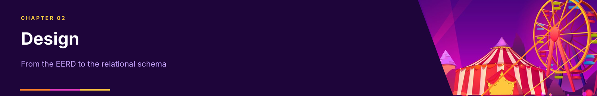</p>

## 2 Design

### 2.1 The EERD

<p align="center"><a href="docs/readme/report/eerd.png">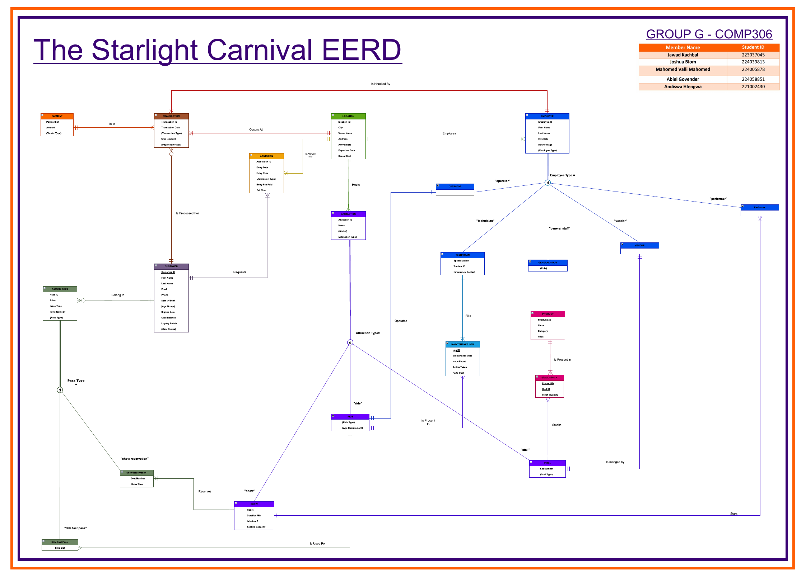</a></p>

<p align="center"><sub><b>Figure 1.</b> Our EERD (select to enlarge). The circles marked <b>d</b> are the three disjoint specialisations: employee type, attraction type and pass type.</sub></p>

### 2.2 The relational schema

<p align="center"><a href="docs/readme/report/relational-schema.png">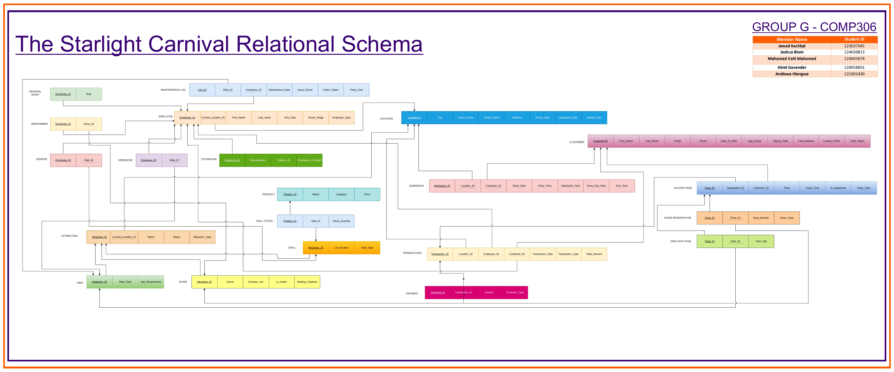</a></p>

<p align="center"><sub><b>Figure 2.</b> Our relational schema (select to enlarge). It was drawn before the final SQL, which refined a few names: the operator's ride link became a <code>ride_responsibility</code> category, and the maintenance log's technician key is <code>technician_id</code>.</sub></p>

### 2.3 The three specialisations

| Supertype      | Discriminator column | Subtype tables                                                      | Shared key             |
|----------------|----------------------|---------------------------------------------------------------------|------------------------|
| `ATTRACTION`   | `attraction_type`    | `RIDE`, `SHOW`, `STALL`                                             | `attraction_id`        |
| `EMPLOYEE`     | `employee_type`      | `OPERATOR`, `TECHNICIAN`, `VENDOR`, `PERFORMER`, `GENERAL_STAFF`    | `employee_id`          |
| `ACCESS_PASS`  | `pass_type`          | `RIDE_FAST_PASS`, `SHOW_RESERVATION`                                | `pass_id`              |

Each subtype table uses the supertype's key as its own primary key and foreign key with `ON DELETE CASCADE`, so deleting an employee removes the matching subtype row with it.

[Back to top ↑](#top)

<p align="center">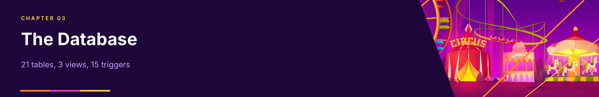</p>

## 3 The Database

### 3.1 What the script builds

| Object            | Count | Notes                                                                              |
|-------------------|:-----:|------------------------------------------------------------------------------------|
| Tables            | 21    | 12 core tables and 9 subtype tables                                                |
| Views             | 3     | `VW_SALES_SUMMARY`, `VW_MAINTENANCE_OVERVIEW`, `VW_GUEST_REPORTS`                  |
| Triggers          | 15    | age group, loyalty points, payment validation, subtype guards                      |
| Stored procedures | 2     | `TopUpCard`, `DeductBalance`                                                       |
| Indexes           | 3     | transaction date, admission date, maintenance date, for reporting                  |
| Accounts          | 4     | admin, sales, maintenance, guest                                                   |

### 3.2 Constraints

Business rules are written into the tables as `CHECK` constraints, so they hold no matter which client connects:

| Table          | Rule                                                                                                           |
|----------------|----------------------------------------------------------------------------------------------------------------|
| `LOCATION`     | departure on or after arrival; rental cost not negative                                                        |
| `CUSTOMER`     | balance and loyalty points not negative; age group is Child, Adult or Senior; status is ACTIVE, SUSPENDED or EXPIRED; email is unique |
| `ADMISSION`    | admission type is Child, Adult or Senior; fee not negative                                                     |
| `TRANSACTION`  | type is Entry Fee, Card Top-Up, Stall Purchase, Refund or Access Pass; total not negative                      |
| `PAYMENT`      | amount above zero; tender is Cash, Credit Card, Debit Card or Smart Card                                       |
| `ATTRACTION`   | type is Ride, Show or Stall; status is Operational, Closed or Maintenance                                      |
| `EMPLOYEE`     | hourly wage above zero; type is Operator, Technician, Vendor, Performer or General                             |
| `VENDOR`       | `stall_id` is unique: one vendor per stall                                                                     |
| `STALL_STOCK`  | stock not negative; key is (product, stall)                                                                    |

### 3.3 Triggers

| Trigger                                                     | What it does                                                                                                    |
|-------------------------------------------------------------|-----------------------------------------------------------------------------------------------------------------|
| `before_customer_insert`, `before_customer_update`          | Derive `age_group` from the date of birth: under 13 is Child, 60 and over is Senior, otherwise Adult            |
| `after_transaction_insert`                                  | Award **1 loyalty point per R10** (rounded down) on every transaction for a customer except refunds            |
| `before_payment_insert`                                     | Reject a payment of zero or less                                                                                |
| `before_ride_insert`, `before_show_insert`, `before_stall_insert`, `before_attraction_type_update` | A subtype row needs a matching discriminator, and an attraction cannot have two subtypes |
| `before_operator_insert`, `before_technician_insert`, `before_vendor_insert`, `before_performer_insert`, `before_general_staff_insert`, `before_employee_type_update` | The same guard for employees |
| `before_access_pass_insert`                                 | Only `RideFastPass` and `ShowReservation` are valid pass types                                                  |

### 3.4 Stored procedures

- **`TopUpCard(customer, amount)`** adds to the card balance and rejects an amount of zero or less.
- **`DeductBalance(customer, amount)`** subtracts from the balance, and fails with *Customer not found* or *Insufficient card balance* instead of silently doing nothing.

Neither touches loyalty points: the trigger above already awards them, so doing it twice would double-count.

### 3.5 Views

| View                       | Intended for     | Contents                                                                  |
|----------------------------|------------------|---------------------------------------------------------------------------|
| `VW_SALES_SUMMARY`         | Sales            | Transactions with their payments, customer name and venue                 |
| `VW_MAINTENANCE_OVERVIEW`  | Maintenance      | Each log entry with the ride name and technician name resolved            |
| `VW_GUEST_REPORTS`         | Guest            | Admissions and transaction counts and revenue per venue                   |

### 3.6 Sample data

The script seeds enough data to exercise every screen:

| Table group           | Rows seeded                                                                       |
|-----------------------|-----------------------------------------------------------------------------------|
| Locations             | 3: Kings Park Showgrounds (Durban), Grand Parade Fairgrounds (Cape Town), Nasrec Expo Centre (Johannesburg) |
| Customers             | 10                                                                                |
| Employees             | 10, two of each of the five types                                                 |
| Attractions           | 9: three rides, three shows, three stalls                                         |
| Admissions            | 8                                                                                 |
| Transactions, payments| 10 and 10                                                                         |
| Access passes         | 2                                                                                 |
| Products, stall stock | 8 and 8                                                                           |
| Maintenance logs      | 3                                                                                 |

All seeded activity is at the first stop, Kings Park Showgrounds; the other two venues exist as locations but have no admissions yet.

[Back to top ↑](#top)

<p align="center">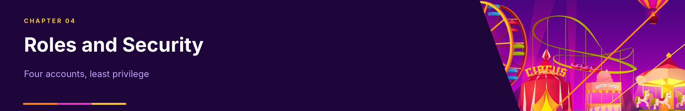</p>

## 4 Roles and Security

We did not build a login table in the application. The login screen takes a **MySQL account**, and MySQL itself decides what that account may do. A buggy or modified client therefore cannot step outside its role, because the server refuses the statement.

### 4.1 Privilege matrix

| Account                 | Can read                                                                  | Can write                                                                              | Can run                          |
|-------------------------|---------------------------------------------------------------------------|----------------------------------------------------------------------------------------|----------------------------------|
| `starlight_admin`       | Everything                                                                | Everything in `starlight_carnival`                                                     | Everything                       |
| `starlight_sales`       | Customers, admissions, transactions, payments, passes, locations, attractions, rides, shows, the sales view | Customers, admissions, transactions, passes (insert and update); payments and the two pass-subtype tables (insert only) | `TopUpCard`, `DeductBalance` |
| `starlight_maintenance` | Maintenance log, rides, attractions, technicians, employees, the maintenance view | Maintenance log (insert, update); technician (update)                                  |                                  |
| `starlight_guest`       | Every table and view                                                      | Nothing                                                                                |                                  |

### 4.2 How the application maps roles to screens

`LoginFrame` asks `DatabaseManager` to connect with the typed credentials, and the **username decides the window**: a name containing `admin` (or `root`) opens the full admin shell, `sales` opens the sales workflow, `maint` or `maintenance` opens the maintenance portal, and anything else opens the read-only shell. This only chooses which screen is shown; the real enforcement is the MySQL grants above.

[Back to top ↑](#top)

<p align="center">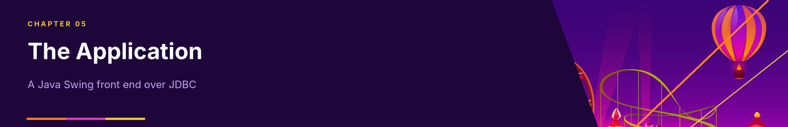</p>

## 5 The Application

### 5.1 Architecture

The front end is a Java Swing desktop application that talks to MySQL through Connector/J. It is nine classes, each with one job:

| Class                  | Responsibility                                                                                                         |
|------------------------|------------------------------------------------------------------------------------------------------------------------|
| `Main`                 | Sets the look and feel and the combo-box colours, then opens the login screen                                          |
| `LoginFrame`           | Animated login (a starfield behind the card), authentication and role routing                                          |
| `DatabaseManager`      | A singleton holding one JDBC connection, with `query`, `update` and `inTransaction` helpers and a schema check        |
| `EntityConfig`         | Declarative metadata for every entity: table, key, fields and types, dropdowns, foreign keys and subtype definitions  |
| `EntityCrudPanel`      | One generic create, read, update and delete panel, built at run time from an `EntityConfig`                            |
| `MainFrame`            | The admin and guest shell: a sidebar of entities and a reports page                                                    |
| `SalesFrame`           | The four-step workflow for the sales role                                                                              |
| `MaintenanceFrame`     | The two screens for the maintenance role                                                                               |
| `ReportsPanel`         | Five report queries, each shown as a card                                                                              |

Every query uses `PreparedStatement` with bound parameters, so user input is never concatenated into SQL.

### 5.2 One panel for every entity

Rather than hand-build a form for each of the entities, we describe each one once in `EntityConfig` and let `EntityCrudPanel` draw the form, the grid and the SQL. A foreign-key field becomes a dropdown filled from the referenced table, fixed value sets become dropdowns, and supertypes show an extra subtype selector that swaps in that subtype's own fields. The supertype row and subtype row are saved together inside one database transaction, so they commit or roll back as a pair. Adding a new entity means writing one configuration entry, not a new screen.

The admin sidebar groups the entities: **Core** (locations, customers, admissions), **Employees** (all, operators, technicians, vendors, performers, general staff), **Attractions** (all, rides, shows, stalls), **Commerce** (transactions, payments, products, stall stock), **Passes and logs** (access passes, fast passes, show reservations, maintenance logs) and **Analytics** (reports). The guest sees the same sidebar with **Add, Edit and Delete removed**.

### 5.3 The sales workflow

The sales role does not see tables. It walks through a four-step pipeline:

1. **Find the cardholder** by name, email or customer ID, or register a **new customer** on the spot.
2. **Admission:** choose the location, the admission type, the tender and the entry fee. This writes the admission, an *Entry Fee* transaction and its payment.
3. **Access pass (optional):** choose a Ride Fast Pass or a Show Reservation, pick the ride or show, and enter the price and tender. This writes the transaction, the payment, the pass and its subtype row.
4. **Complete:** a summary of what was created.

### 5.4 The maintenance portal

Maintenance staff get two screens: **New Maintenance Record** (pick the ride, the technician, describe the issue and the action, enter the parts cost; the ride list shows rides only and the technician list shows technicians only) and **View Maintenance Records**, a grid with ride and technician names resolved through joins.

### 5.5 Look and feel

All screens share a dark theme with an amber accent. Combo boxes are coloured globally at start-up, which fixed a white-on-white text bug that appeared under the Windows look and feel, and tables use alternating row colours.

### 5.6 Screenshots

The screenshots below are in the order they were captured. Select any image to open it at full size.

<p align="center"><a href="https://github.com/user-attachments/assets/9c184a88-7959-40e5-839f-8bb95b3be8af"></a><br><sub>Login screen</sub></p>

<p align="center"><a href="https://github.com/user-attachments/assets/5258bb68-922c-43f0-a2e6-a773afe84385"></a><br><sub>Admin shell: entity grid</sub></p>

<p align="center"><a href="https://github.com/user-attachments/assets/75ac81e9-4c72-4202-bf55-9d728f75102d"></a><br><sub>Admin shell: add and edit form</sub></p>

<p align="center"><a href="https://github.com/user-attachments/assets/c0321ce8-7334-4d41-aab7-fca91e259aaf"></a><br><sub>Admin shell: subtype fields</sub></p>

<table align="center"><tr><td align="center" width="50%"><a href="https://github.com/user-attachments/assets/4c45d3e0-3886-489f-9788-e710b7996ac3"></a><br><sub>Sales: find the cardholder</sub></td><td align="center" width="50%"><a href="https://github.com/user-attachments/assets/f8a544d0-6114-47f6-b1d0-2fdf834bb8eb"></a><br><sub>Sales: admission details</sub></td></tr></table>

<table align="center"><tr><td align="center" width="50%"><a href="https://github.com/user-attachments/assets/ac65431f-3007-4b83-82ca-ae43a2e64e78"></a><br><sub>Sales: access pass</sub></td><td align="center" width="50%"><a href="https://github.com/user-attachments/assets/c04b4241-2308-40c8-ad9c-2f39c60c054a"></a><br><sub>Sales: summary</sub></td></tr></table>

<p align="center"><a href="https://github.com/user-attachments/assets/7c9678d9-4e97-4a38-b3ce-2c5247dc1fcf"></a><br><sub>Maintenance: new record</sub></p>

<p align="center"><a href="https://github.com/user-attachments/assets/c8319097-bec0-44ca-aa5c-3e920ad1e29d"></a><br><sub>Maintenance: records grid</sub></p>

<p align="center"><a href="https://github.com/user-attachments/assets/eb92d40a-e5cd-49f3-b950-6879fb0153c8"></a><br><sub>Reports</sub></p>

[Back to top ↑](#top)

<p align="center">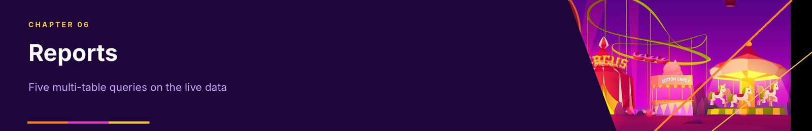</p>

## 6 Reports

`ReportsPanel` runs five queries in the background with `SwingWorker`, so the window never freezes, and draws each as a card. Each joins three or more tables. The figures below are what they return on the **sample data** shipped in the script.

### 6.1 Revenue by location and admission type

Joins `ADMISSION`, `LOCATION` and `CUSTOMER`, grouped by venue, admission type and age group. It answers *how does admission revenue break down across the tour?*

| Location                | Admission type | Age group | Admissions | Revenue | Unique customers |
|-------------------------|----------------|-----------|-----------:|--------:|-----------------:|
| Kings Park Showgrounds  | Adult          | Adult     | 5          | 600.00  | 5                |
| Kings Park Showgrounds  | Child          | Adult     | 2          | 160.00  | 2                |
| Kings Park Showgrounds  | Senior         | Adult     | 1          | 90.00   | 1                |

### 6.2 Ride maintenance summary

Joins `RIDE`, `ATTRACTION` and `MAINTENANCE_LOG`. It answers *which rides are eating the maintenance budget?*

| Ride             | Type    | Jobs | Parts cost | Technicians |
|------------------|---------|-----:|-----------:|------------:|
| Gravity Spinner  | Motion  | 1    | 1,850.00   | 1           |
| Thunder Coaster  | Thrills | 1    | 320.00     | 1           |
| Kiddies Carousel | Kiddies | 1    | 95.00      | 1           |

### 6.3 Products by stall stock

Joins `PRODUCT`, `STALL_STOCK`, `STALL` and `ATTRACTION`. It answers *what is on sale where, and how much is left?* The sample data stocks two of the three stalls (Carnival Bites and Souvenir Corner); the Slushie (120 units), Fruit Juice (100) and Boerewors Roll (80) lead the list.

### 6.4 Employee distribution by location

Joins `EMPLOYEE`, `LOCATION` and all five subtype tables, and returns the count, average wage and earliest hire date per location and type. It also doubles as an integrity check: an employee who has no subtype row shows up as **Unassigned**.

| Location               | Type       | Count | Average wage |
|------------------------|------------|------:|-------------:|
| Kings Park Showgrounds | Operator   | 2     | 52.50        |
| Kings Park Showgrounds | Technician | 2     | 69.00        |
| Kings Park Showgrounds | Vendor     | 2     | 45.00        |
| Kings Park Showgrounds | Performer  | 2     | 59.00        |
| Kings Park Showgrounds | General    | 2     | 50.00        |

### 6.5 Customer loyalty and spending

Joins `CUSTOMER`, `TRANSACTION` and `PAYMENT`, and lists up to 50 customers by total spend, with card balance and points. It answers *who are our best customers, and do their points match what they spent?* On the sample data the top five are:

| Customer        | Card balance | Points | Transactions | Total spent |
|-----------------|-------------:|-------:|-------------:|------------:|
| Connor Joubert  | 500.00       | 20     | 1            | 200.00      |
| Amara Nkosi     | 250.00       | 17     | 2            | 175.00      |
| Liam Botha      | 180.00       | 16     | 2            | 160.00      |
| Sipho Mthembu   | 130.00       | 15     | 1            | 150.00      |
| Priya Pillay    | 150.00       | 12     | 1            | 120.00      |

[Back to top ↑](#top)

<p align="center">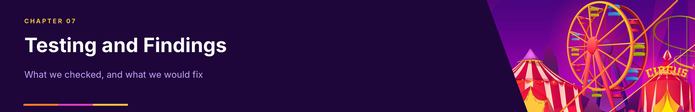</p>

## 7 Testing and Findings

For this README we loaded the script into a clean database server, compiled the Java sources, started the application, and tried the rules described above directly. This section records what held and what we would fix.

### 7.1 What we checked

| Check                                                                       | Result                                                                                       |
|-----------------------------------------------------------------------------|----------------------------------------------------------------------------------------------|
| The script loads on a clean server                                          | 21 tables, 3 views, 15 triggers and 2 procedures created with no errors                      |
| The Java sources compile                                                    | Clean, with no warnings that stop the build, on JDK 21                                       |
| Each of the four accounts logs in and reaches its own screen                | Admin: full sidebar with Add, Edit and Delete. Sales: Cardholder Admission and New Customer. Maintenance: the portal. Guest: the same sidebar with no write buttons |
| Age group from date of birth                                                | 8 years old is Child, 70 is Senior, 30 is Adult                                              |
| Loyalty points                                                              | A R255 transaction awards 25 points (255 ÷ 10, rounded down)                                 |
| `TopUpCard` and `DeductBalance`                                             | +100 gives a balance of 100, then −30 gives 70; overdrawing gives *Insufficient card balance*; a zero top-up gives *Top-up amount must be positive* |
| Constraints                                                                 | A negative payment, a negative card balance and an unknown pass type are all refused         |
| Disjoint subtypes                                                           | A Show row for a Ride attraction, a Technician row for an Operator, and changing a Ride's attraction type are all refused |
| Least privilege                                                             | Guest and sales cannot delete; sales cannot read employees or stalls; maintenance cannot read customers or delete log entries |

### 7.2 Findings we would fix

We found these while checking, and list them so nobody is surprised.

| # | Finding                                                                                                                                                                                                 | Where                       |
|---|---------------------------------------------------------------------------------------------------------------------------------------------------------------------------------------------------------|-----------------------------|
| 1 | **`VW_GUEST_REPORTS` overstates revenue.** It joins admissions and transactions in one query, so each total is multiplied by the other table's row count. On the sample data it reports 8,500 admission revenue (the real figure is 850) and 8,480 transaction revenue (the real figure is 1,060). The Swing app does not query this view; the fix is to total each table in its own subquery first. | `starlight_carnival.sql`    |
| 2 | **The customer report double-counts a split payment.** Report 5 sums the transaction total after joining payments, so a transaction paid in two parts is counted twice. In a test, a 200.00 transaction paid in two parts showed 400.00 spent. The sample data has one payment per transaction, so the shipped figures are right. | `ReportsPanel.java`         |
| 3 | **The sales steps save one at a time.** The admission, its transaction and its payment are separate statements, and the pass is a further set. If one fails part-way, the earlier rows stay. Wrapping each step in `inTransaction` (which the generic CRUD panel already uses) would fix it. The sales transactions also do not record the employee who processed them. | `SalesFrame.java`           |
| 4 | **The admission-type dropdown offers VIP and Group**, but the table only allows Child, Adult and Senior, so choosing either is refused by the database. | `SalesFrame.java`           |
| 5 | **The stored procedures are not called by the app.** Paying by *Smart Card* in the sales workflow records the payment but does not reduce the card balance, because `DeductBalance` is never used. | `SalesFrame.java`           |
| 6 | **Passes record the time of sale, not a chosen slot.** The ride time slot and show time are set to the current time, so the scenario's "designated time slot" is not yet selectable. | `SalesFrame.java`           |
| 7 | **Top-ups earn loyalty points.** The trigger rewards every transaction type except refunds, including card top-ups, so money is rewarded when it is loaded and again when it is spent. | `starlight_carnival.sql`    |
| 8 | **"Exactly one subtype" is enforced one way.** The triggers stop a second subtype, but nothing stops a supertype row from having none. Report 4's *Unassigned* check is how we spot that. | `starlight_carnival.sql`    |
| 9 | **The sample data sits at one stop.** Only Kings Park has admissions, transactions and staff, so the location comparisons show a single venue. | `starlight_carnival.sql`    |

### 7.3 Assumptions

- **Age thresholds.** The scenario does not give ages, so the trigger uses under 13 for Child and 60 or over for Senior.
- **Currency.** Loyalty points assume rands (1 point per R10).
- **Single server.** The application holds one connection per run, which is fine for a desktop demonstration but not for a multi-user deployment.
- **Demo credentials.** The passwords in the script are for coursework only.

[Back to top ↑](#top)

<p align="center">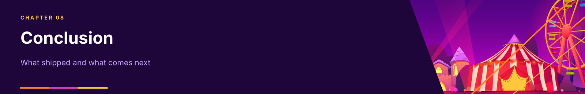</p>

## 8 Conclusion

The Starlight Carnival system turns a messy, constantly moving operation into one consistent schema: 21 tables, three disjoint specialisations kept honest by triggers, validated money handling, and four role-limited accounts that the database itself enforces. On top of it, a generic Swing front end gives each role the screens it needs, and five multi-table reports answer the questions management asked in the scenario.

Three lessons stand out. Modelling the specialisations properly paid off, because the same pattern gave us staff, attractions and passes for the price of one idea. Putting rules in the database rather than the app meant the application could stay simple and still be safe. And checking the finished system against its own scenario, as in the findings above, is where the remaining gaps showed up. Next we would fix the revenue view, make the sales steps atomic, wire in the stored procedures, and add data for the other two stops.

[Back to top ↑](#top)

<p align="center">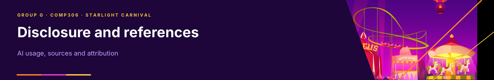</p>

## References

Elmasri, R. and Navathe, S. (2016) *Fundamentals of Database Systems*. 7th edn. Hoboken: Pearson.

Oracle (2024) *MySQL 8.0 Reference Manual*. Available at: https://dev.mysql.com/doc/refman/8.0/en/

Oracle (2024) *MySQL Connector/J Developer Guide*. Available at: https://dev.mysql.com/doc/connector-j/en/

Oracle (2024) *Java Platform, Standard Edition: Swing Tutorial*. Available at: https://docs.oracle.com/javase/tutorial/uiswing/

## AI disclosure

We used AI tools as a supplementary aid on this project: checking that the business scenario holds together and that no relationships were missing, polishing entity details, proofreading our written documents, reviewing our code, and helping with routine front-end work such as the generic form generation and consistent styling. Our project documentation was drafted with AI assistance from our source files, the EERD, the relational schema and the Phase 1 scenario, and says so in its title. The design decisions, the business logic and the architecture of the application are ours.

This README was drafted with the help of Claude (Anthropic) from our documents and source code. The test results in Section 7 come from loading the script into a clean database server, compiling and running the application, and executing the checks directly.

## Licence and attribution

No licence file has been added to this repository. This project is our university coursework as Group G, and "The Starlight Carnival" is the fictional business of the assignment.

<p align="center"><sub>GROUP G · COMP306 · THE STARLIGHT CARNIVAL · UNIVERSITY OF KWAZULU-NATAL · 2026</sub></p>

<p align="right"><sub><a href="#top">Back to top ↑</a></sub></p>
